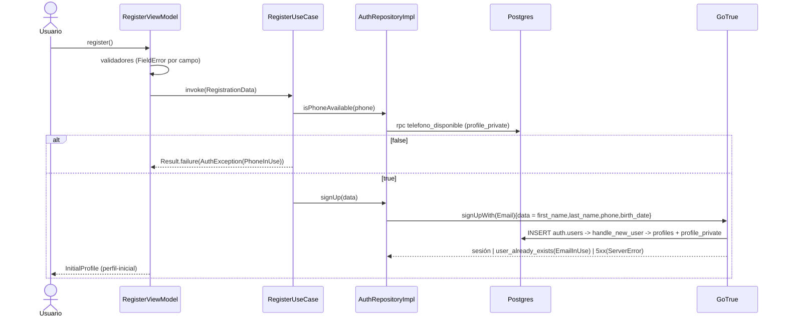
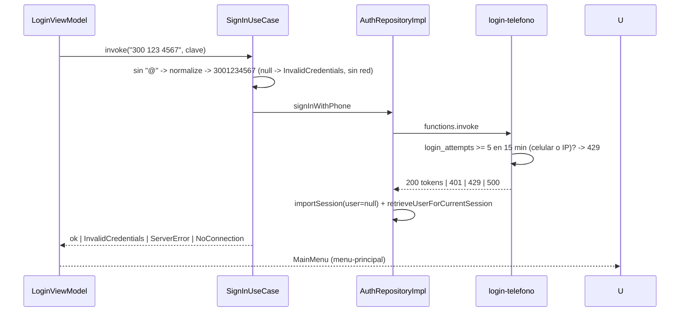

# Design: Registro, login y recuperación de contraseña (HU-001..HU-004) — v2 adaptado al código existente

> Supera las 800 palabras: el orquestador pidió cambio de esquema, contratos, diagramas y tablas. Rediseño sobre `fa422ae` (HU-025/027/028, postulaciones, menú, CI).

## Technical Approach

Se adopta la arquitectura **por capas que ya usa el equipo** (`domain/{model,repository,usecase}`, `data/repository`, `ui/<feature>`, `di/`), identificadores en **inglés** (como `MissionViewModel`, `uiState`, `isLoading`) y textos/KDoc en español. Patrón del equipo: el repositorio **lanza**, el caso de uso envuelve en `Result<T>`, el ViewModel expone `StateFlow<XUiState>` y la pantalla obtiene el VM con `koinViewModel()`. Se extiende el `AuthRepository` existente (sin implementación ni llamadores) y se integra con la navegación manual de `MainActivity`. Se mantiene todo lo verificado de gotrue-kt 2.6.0: `importSession`/`importAuthToken`, `verifyEmailOtp(OtpType.Email.RECOVERY, email, token)`, `resetPasswordForEmail`, `updateUser { password }`, `AuthRestException.errorCode`, `sessionStatus`.

## Architecture Decisions

| # | Decisión | Rechazado | Rationale |
|---|----------|-----------|-----------|
| D1 | Capas existentes + identificadores en inglés | Paquetes por feature (`features/auth`), nombres en español | Conformidad con el código del equipo |
| D2 | Repo lanza `AuthException(error: AuthError)`; casos de uso devuelven `Result<T>` vía `authCatching {}` (relanza `CancellationException`) | `AuthResult` sellado propio | Mismo contrato que `GetMissionsUseCase`; errores tipados igual |
| D3 | Casos de uso con lógica real: detección correo/celular, colapso de errores de login, chequeo de celular previo al signUp, confirmación neutra | Lógica en VM (v1) | Patrón del equipo; lógica pura testeable sin VM |
| D4 | Navegación manual: `AppDestination` sellado se mueve de `MainActivity` a `ui/navigation/AppNavigation.kt` y se agregan destinos auth | navigation-compose | No reescribir la navegación de los compañeros; mantiene `MainActivity` < 250 líneas (detekt LongMethod) |
| D5 | Destino inicial decidido **una vez** por `SessionViewModel` (Loading -> Login o MainMenu) | Reacción global a `sessionStatus` | Registro y recuperación crean sesión; evitar saltos |
| D6 | `perfil-inicial` = `FeaturePlaceholderScreen("Configuración inicial de perfil")` cuyo `onBack` va a `MainMenu` | Stub propio; ir directo al menú | Cumple la spec (navega a `perfil-inicial`) reutilizando el placeholder existente; el dueño de HU-005 solo reemplaza la rama |
| D7 | `nombre` y `apellido` separados (`firstName`/`lastName`); el trigger deriva `full_name` | Seguir con `fullName` único | HU-001 los pide separados; `full_name` sigue intacto para `profiles(full_name)` de misiones |
| D8 | PII a tabla `profile_private` con RLS de fila propia | Grants por columna en `profiles` | Ver sección Esquema |
| D9 | Cambios BD: editar `schema.sql` (estado final) + script idempotente `supabase/changes/2026-11-03_auth_profiles_privacy.sql` para la BD viva | Iniciar `supabase/migrations/` | El equipo no usa Supabase CLI ni tiene baseline; adoptar migraciones exige `db pull` y acuerdo de Juan/Alex |
| D10 | Login celular vía Edge Function `login-telefono` con `functions-kt`; responde la sesión **sin `user`**; app `importSession(UserSession(..., user = null))` + `retrieveUserForCurrentSession(updateSession = true)`; fallback `importAuthToken(access, refresh, retrieveUser = true)` | RPC que devuelve correo | Spec "Correo no expuesto": el cuerpo no lleva correo ni metadata |
| D11 | Secretos desde `local.properties` -> `BuildConfig` (ya existe); se elimina el plan `.env` | `.env` | Ya implementado por el equipo; solo corregir README |
| D12 | Errores en estado como enums (`AuthError`, `FieldError`); textos en `ui/auth/AuthMessages.kt` (literales español, como el equipo) | `strings.xml`, `String` en UiState | Tests verifican enums, no textos |
| D13 | Código expirado e inválido: un único `AuthError.InvalidOrExpiredCode` con el mensaje "Código inválido o expirado" | Distinguir por tiempo desde el envío (TTL en el cliente) | GoTrue devuelve `otp_expired` en ambos casos; la spec se unificó (decisión del usuario) |
| D14 | `java.time.Clock` inyectado en `BirthDateValidator` | `LocalDate.now()` | Tests deterministas |
| D15 | Límite de intentos en `login-telefono`: 5 fallos en 15 min por celular **o** por IP de cliente -> 429 con el mismo cuerpo genérico; tabla `login_attempts` (solo service role) | Solo el límite de GoTrue; límite en el cliente | GoTrue limita por IP y todas las llamadas salen de la IP de la función: el límite se compartiría entre usuarios y no frenaría fuerza bruta por celular. Login por correo sigue solo con GoTrue |

## File Changes

Base `app/src/main/java/com/groovycow/misionessecundarias/`.

| Archivo | Accion | Descripcion |
|---------|--------|-------------|
| `domain/repository/AuthRepository.kt` | Modify | Nueva firma (ver Contratos); sin llamadores, no rompe nada |
| `domain/model/AuthError.kt` | Create | `sealed interface AuthError` + `class AuthException(val error: AuthError)` |
| `domain/model/SessionState.kt`, `domain/model/RegistrationData.kt` | Create | Estado de sesión; datos de registro |
| `domain/validation/` `ValidationResult.kt`, `FieldError.kt`, `EmailValidator.kt`, `PasswordValidator.kt`, `PhoneValidator.kt`, `BirthDateValidator.kt`, `NameValidator.kt`, `RecoveryCodeValidator.kt` | Create | Validadores puros |
| `domain/usecase/` `RegisterUseCase.kt`, `SignInUseCase.kt`, `RequestPasswordResetUseCase.kt`, `VerifyRecoveryCodeUseCase.kt`, `ChangePasswordUseCase.kt`, `ObserveSessionUseCase.kt`, `AuthCatching.kt` | Create | Ver D3 |
| `data/repository/AuthRepositoryImpl.kt` | Create | Supabase Auth/Postgrest/Functions; DTOs `@Serializable` privados en el mismo archivo (estilo del equipo) |
| `data/repository/AuthErrorMapper.kt` | Create | `Throwable` + operación -> `AuthError`, puro |
| `ui/auth/SessionViewModel.kt`, `ui/auth/AuthMessages.kt` | Create | Arranque; textos |
| `ui/auth/login/LoginScreen.kt`, `LoginViewModel.kt` | Create | HU-002 |
| `ui/auth/register/RegisterScreen.kt`, `RegisterViewModel.kt` | Create | HU-001 |
| `ui/auth/recovery/RequestCodeScreen.kt`, `RequestCodeViewModel.kt`, `ResetPasswordScreen.kt`, `ResetPasswordViewModel.kt` | Create | HU-003/004 |
| `ui/navigation/AppNavigation.kt` | Create | `AppDestination` + `when` movidos desde `MainActivity` + destinos auth + `BackHandler` en sub-pantallas auth |
| `MainActivity.kt` | Modify | `setContent { MisionesSecundariasTheme { AppNavigation() } }` (comportamiento de misiones/postulaciones idéntico) |
| `di/AuthModule.kt` | Create | Modulo Koin auth |
| `di/SupabaseModule.kt` | Modify | `install(Functions)` |
| `MisionesApp.kt` | Modify | `modules(supabaseModule, repositoryModule, authModule)` |
| `app/src/main/AndroidManifest.xml` | Modify | `<uses-permission android:name="android.permission.INTERNET" />` explícito (hoy no está; solo llegaría por merge transitivo) |
| `gradle/libs.versions.toml`, `app/build.gradle.kts` | Modify | `supabase-functions = { group = "io.github.jan-tennert.supabase", name = "functions-kt", versión.ref = "supabase" }` + `implementation(libs.supabase.functions)`. Nada más: okhttp, serialization y `koinViewModel` ya existen |
| `supabase/schema.sql` | Modify | Estado final (sección Esquema) |
| `supabase/changes/2026-11-03_auth_profiles_privacy.sql` | Create | Script idempotente para la BD viva |
| `supabase/changes/2026-11-03_login_attempts.sql` | Create | Tabla `login_attempts`, índices y función de limpieza (HU-002) |
| `supabase/functions/login-telefono/index.ts` | Create | Edge Function (Deno, JSDoc) |
| `README.md` | Modify | Setup con `local.properties` (hoy dice `.env`, incorrecto) + checklist dashboard |
| `.env.example` | Delete | Obsoleto (coordinar con Alex) |
| `.gitignore` | Modify | `release/`,`debug/` -> `/release/`,`/debug/` (ignorarian `app/src/debug/`); `schemas/  # ...` tiene comentario en línea (git no lo soporta) |

Tests nuevos en `app/src/test/java/com/groovycow/misionessecundarias/`: `domain/validation/*Test.kt`, `domain/usecase/{Register,SignIn,RequestPasswordReset,ChangePassword}UseCaseTest.kt`, `data/repository/AuthErrorMapperTest.kt`, `ui/auth/**/*ViewModelTest.kt`, `testutil/MainDispatcherRule.kt`.

## Interfaces / Contracts

```kotlin
sealed interface AuthError {
    data object InvalidCredentials : AuthError; data object EmailInUse : AuthError
    data object PhoneInUse : AuthError;         data object WeakPassword : AuthError
    data object InvalidOrExpiredCode : AuthError; data object SamePassword : AuthError
    data object NoConnection : AuthError;       data object ServerError : AuthError
}
class AuthException(val error: AuthError) : Exception()
enum class SessionState { LOADING, AUTHENTICATED, UNAUTHENTICATED }
data class RegistrationData(val firstName: String, val lastName: String, val email: String,
    val phone: String /* normalizado */, val birthDate: LocalDate, val password: String)

interface AuthRepository {
    fun observeSession(): Flow<SessionState>
    suspend fun isPhoneAvailable(phone: String): Boolean           // rpc telefono_disponible
    suspend fun signUp(data: RegistrationData)                      // reemplaza signUp(email,password,fullName,phone)
    suspend fun signIn(email: String, password: String)             // se conserva
    suspend fun signInWithPhone(phone: String, password: String)    // Edge Fn login-telefono
    suspend fun sendPasswordResetCode(email: String)
    suspend fun verifyRecoveryCode(email: String, code: String)
    suspend fun updatePassword(newPassword: String)
    suspend fun signOut()                                           // se conserva
}
```

- `signUp` envia `data = { first_name, last_name, phone, birth_date (ISO) }`.
- `observeSession`: `LoadingFromStorage` -> LOADING; `Authenticated` y `NetworkError` (hay sesión guardada) -> AUTHENTICATED; `NotAuthenticated` -> UNAUTHENTICATED.
- Validadores: `PhoneValidator.normalize(input): String?` (quita espacios, guiones, `+57`; `^3\d{9}$`); `PasswordValidator.unmetRules(pwd): Set<PasswordRule>`; `BirthDateValidator(clock)` (no futura, >= 18, exactamente 18 hoy válido); `RecoveryCodeValidator` `^\d{6,10}$`; `NameValidator` no vacío tras trim, <= 60.
- UiState (estilo equipo, `data class` con defaults): `LoginUiState(identifier, password, fieldErrors, isLoading, error: AuthError?, isSignedIn)`; `RegisterUiState(...campos, fieldErrors: Map<RegisterField, FieldError>, isLoading, error, isRegistered)`; `RequestCodeUiState(email, emailError, isLoading, error, isCodeSent)`; `ResetPasswordUiState(code, password, confirmation, fieldErrors, isLoading, error, codeVerified, resendAvailableIn: Int, isPasswordChanged)`. La pantalla observa el flag de éxito en `LaunchedEffect` y llama su callback (`onSignedIn`, `onRegistered`, ...). Boton deshabilitado con `isLoading` (spec "Estado de carga").
- `ResetPasswordViewModel(email, useCases)` vía `koinViewModel { parametersOf(email) }`; si `updatePassword` falla tras verificar, `codeVerified = true` y solo reintenta la clave; reenvío con cuenta regresiva de 60 s.

Navegación (`AppDestination`): `Login`, `Register`, `RequestCode`, `ResetPassword(email)`, `InitialProfile` (= `perfil-inicial`), `MainMenu` (= `menu-principal`, la `MainMenuScreen` real) y los destinos existentes. `AppNavigation` mantiene `var destination: AppDestination?`; mientras `SessionViewModel` emite LOADING muestra un `CircularProgressIndicator`; al primer valor distinto lo fija una sola vez.

```kotlin
val authModule = module {
    single<Clock> { Clock.systemDefaultZone() }
    single { AuthErrorMapper() }
    single<AuthRepository> { AuthRepositoryImpl(get(), get()) }
    factory { RegisterUseCase(get()) }; factory { SignInUseCase(get()) } /* ...resto */
    factory { BirthDateValidator(get()) }
    viewModel { SessionViewModel(get()) }; viewModel { LoginViewModel(get()) }
    viewModel { RegisterViewModel(get(), get()) }; viewModel { RequestCodeViewModel(get(), get()) }
    viewModel { (email: String) -> ResetPasswordViewModel(email, get(), get(), get()) }
}
```

## Esquema (cambio de seguridad)

Hoy `profiles` tiene `SELECT USING (true)` + `GRANT SELECT TO anon`: **cualquiera con la anon key lee todos los celulares**. Unico lector de `profiles` en la app: `MissionRepositoryImpl` con `profiles(full_name)`; nadie lee `phone`.

| Opción | Tradeoff | Decisión |
|--------|----------|----------|
| `profile_private(id, phone, birth_date)` con RLS fila propia | Una tabla más; trigger escribe dos filas | **Elegida**: `profiles` queda 100% público sin sorpresas; el dueño puede leer su PII |
| Grants por columna en `profiles` | `select=*` (y `profiles(*)`) pasa a fallar para todos; el dueño no ve su celular sin RPC | Rechazada: frágil para compañeros |

Contenido (en `schema.sql` y en el script de cambio, idempotente con `if not exists` / `drop ... if exists`; cada objeto con `COMMENT ON`):
- `profiles`: `add column first_name text, last_name text` (nullable por filas legado; CHECK `char_length(btrim(x)) between 1 and 60` cuando no nulos); `full_name` se mantiene `NOT NULL`; **`drop column phone`** (tras crear `profile_private`). Se elimina la política "Users can insert own profile" (solo el trigger inserta).
- `profile_private(id uuid PK references profiles(id) on delete cascade, phone text not null unique check (phone ~ '^3[0-9]{9}$'), birth_date date not null check (birth_date <= (current_date - interval '18 years')::date), created_at timestamptz default now())`; RLS on; policy `select to authenticated using (auth.uid() = id)`; `revoke all ... from anon, authenticated; grant select ... to authenticated`. El CHECK de edad solo se evalua en insert/update (correcto: la edad solo crece).
- `handle_new_user()` (`security definer set search_path = ''`, nombres calificados): inserta `profiles(id, first_name, last_name, full_name = first||' '||last, role 'user')` y `profile_private(id, phone, birth_date::date)`. Cualquier fallo aborta el signUp (atómico).
- `telefono_disponible(p_telefono text) returns boolean` (`stable security definer search_path=''`, consulta `profile_private`); `revoke execute from public; grant execute to anon, authenticated`. Nombre en español porque la spec lo fija.

Impacto en compañeros: `profiles(full_name)` sigue funcionando sin cambios; FKs de `missions`/`applications` a `profiles(id)` intactas. Filas legado (usuarios de prueba) pierden `phone` y no tienen `profile_private` (no hay `birth_date`): recrearlos desde la app. **Coordinar con Alex y Juan antes de correr el script en la BD compartida.**

## Edge Function `login-telefono` (contrato)

| Aspecto | Contrato |
|---------|----------|
| Request | `POST {"telefono":"3001234567","clave":"..."}` (apikey/Authorization los pone functions-kt) |
| Lógica | normaliza -> **límite**: cuenta fallos de los últimos 15 min en `login_attempts` para ese `phone` o esa IP; si alguno >= 5 -> 429 sin autenticar -> service role `profile_private.select('id').eq('phone')` -> `auth.admin.getUserById` -> cliente anon (`persistSession:false`) `signInWithPassword` -> fallo: inserta intento; éxito: borra fallos del `phone` |
| IP de cliente | primer valor de `x-forwarded-for` (fallback `x-real-ip`); si no hay, solo se limita por celular |
| 200 | `{access_token, refresh_token, expires_in, expires_at, token_type}` — **sin `user`** |
| 400 / 401 / 429 | `{"error":"credenciales_invalidas"}` (mismo cuerpo para celular inexistente, clave mala y bloqueo) |
| 500 | `{"error":"error_interno"}`; nunca loguea correo ni clave |

## Data Flow (solo flujos que cambiaron)





Recuperación: sin cambios respecto a v1 (`resetPasswordForEmail` -> `verifyEmailOtp(RECOVERY)` -> `updateUser{password}` -> `signOut` -> Login).

## Error Mapping

| Origen | `AuthError` | Mensaje (spec) |
|--------|-------------|----------------|
| `user_already_exists` / `email_exists` | EmailInUse | "El correo ya está en uso" |
| RPC false | PhoneInUse | "El celular ya está en uso" |
| `weak_password` / `AuthWeakPasswordException` | WeakPassword | mensaje de contraseña débil |
| `invalid_credentials`, Edge Fn 400/401/429, otro 4xx en LOGIN | InvalidCredentials | "Credenciales incorrectas" |
| `otp_expired` / `invalid_credentials` en VERIFY | InvalidOrExpiredCode | "Código inválido o expirado" |
| `same_password` | SamePassword | "La nueva contraseña debe ser diferente a la anterior" |
| `HttpRequestException`, timeout, `IOException` | NoConnection | "Sin conexión. Intenta de nuevo" |
| 5xx, rate limit de GoTrue (fuera de LOGIN), `unexpected_failure`, otro | ServerError | "Ocurrió un error. Intenta de nuevo" |

Reglas: `SignInUseCase` reduce a {InvalidCredentials, NoConnection, ServerError}; `RequestPasswordResetUseCase` devuelve éxito (confirmación neutra) para todo salvo NoConnection.

## CI / estilo (verificación = CI en `dev/*`, no hay SDK local)

ktlint oficial (comas finales, wrapping multilínea, nombre de archivo = clase única); detekt: métodos < 250 líneas, `CyclomaticComplexMethod` y `ReturnCount` por defecto -> `AuthErrorMapper` dividido en `mapRest(code, op)` / `mapTransport(t)` con `when` expresión; líneas <= 150. Nada lee `BuildConfig` en clases testeadas (en CI está vacío).

## Documentation Convention

KDoc en español en toda clase/interfaz/función/composable público (`@param`, `@return`, `@throws`, `@property`); Edge Function con JSDoc; SQL con cabecera + `COMMENT ON`.

## Testing Strategy (Strict TDD)

| Capa | Qué | Cómo |
|------|-----|------|
| Unit | Validadores | `Clock.fixed(Instant.parse("2026-11-03T12:00:00Z"), ZoneOffset.UTC)` |
| Unit | Casos de uso | `mockk<AuthRepository>()`, `coEvery { ... } throws AuthException(...)`, estilo `GetMissionsUseCaseTest` |
| Unit | `AuthErrorMapper` | construir `AuthRestException`, `IOException` |
| Unit | ViewModels | casos de uso mockeados + `MainDispatcherRule`; `advanceTimeBy` para el reenvío |
| Manual | Límite de intentos | 5 `curl` fallidos -> 6.º con clave correcta da 429; login por correo sigue funcionando |
| Manual | SQL, Edge Fn (`curl`), Gherkin HU-001..004 | Dispositivo + SQL editor |

`AuthRepositoryImpl` no se prueba unitariamente (capa fina).

## Dashboard Checklist (README)

Confirm email **OFF**; política de clave min 8 + lower/upper/digits; plantilla Reset Password con `{{ .Token }}`; OTP 6 dígitos y expiración (p. ej. 900 s); SMTP propio; correr `supabase/changes/2026-11-03_auth_profiles_privacy.sql` y `supabase/changes/2026-11-03_login_attempts.sql`; `supabase functions deploy login-telefono`.

## Límite de intentos en `login-telefono` (HU-002)

Solo login por celular; el login por correo usa el límite de GoTrue. Script `supabase/changes/2026-11-03_login_attempts.sql` (idempotente, con `COMMENT ON`; también en `schema.sql`):

```sql
create table if not exists public.login_attempts (
  id bigint generated always as identity primary key,
  phone text not null,
  client_ip inet,
  attempted_at timestamptz not null default now()
);
create index if not exists login_attempts_phone_idx on public.login_attempts (phone, attempted_at desc);
create index if not exists login_attempts_ip_idx on public.login_attempts (client_ip, attempted_at desc);
alter table public.login_attempts enable row level security;  -- sin políticas: solo service role
revoke all on public.login_attempts from anon, authenticated;

-- Limpieza: borra intentos de más de 1 día. La invoca la función en cada llamada
-- (oportunista); opcionalmente pg_cron: select cron.schedule('purge-login-attempts', '0 * * * *', 'select public.purge_login_attempts()').
create or replace function public.purge_login_attempts() returns void
language sql security definer set search_path = '' as $$
  delete from public.login_attempts where attempted_at < now() - interval '1 day';
$$;
revoke execute on function public.purge_login_attempts() from public, anon, authenticated;
```

Reglas: solo se registran **fallos** (celular inexistente o clave mala); el éxito borra los fallos de ese `phone`; los bloqueados no se registran (no extienden la ventana indefinidamente) y responden 429 con el mismo cuerpo que 401. Constantes `MAX_FAILURES = 5`, `WINDOW_MINUTES = 15` en `index.ts`. Riesgo: varios usuarios tras la misma NAT comparten el contador por IP (aceptado en MVP).

## Migration / Rollout

PR fundación (`AppNavigation`, Koin, functions-kt, manifest, `AuthRepository`, errores, validadores, script SQL) -> `hu/HU-001` -> `hu/HU-002` (+ Edge Fn + `login_attempts`) -> `hu/HU-003` -> `hu/HU-004`. Rollback BD: script inverso (re-agregar `profiles.phone` copiando de `profile_private`, restaurar trigger previo, drop `profile_private`/RPC; drop `login_attempts` y `purge_login_attempts`).

## Diff vs v1

Capas existentes en vez de `core/`+`features/`; identificadores en inglés; casos de uso + `Result` en vez de `AuthResult`; navegación manual en vez de navigation-compose (sin deps nuevas salvo functions-kt); `menu-principal` real y `perfil-inicial` por placeholder existente; `local.properties` en vez de `.env`; PII en `profile_private` y `full_name` derivado; `supabase/changes/` en vez de `migrations/`; Edge Fn sin `user`; login distingue ServerError (spec) y DataRejected eliminado; código inválido/expirado con mensaje unificado; límite de intentos por celular/IP en la Edge Fn (`login_attempts`); permiso INTERNET.

## Open Questions / Spec follow-ups

- [ ] Coordinar con Alex/Juan: script en BD compartida, borrar `profiles.phone`, recrear usuarios de prueba, eliminar `.env.example`, mover `AppDestination` fuera de `MainActivity`.
- [ ] `raw_user_meta_data` conserva celular/fecha (visible solo al titular en su JWT); limpiarlo desde el trigger requiere permisos sobre `auth.users` — evaluar.
- [ ] `profiles` no tiene GRANT UPDATE; cuando HU-005 lo agregue, limitar columnas (nunca `role`).
- [ ] Sin cierre de sesión en la UI (fuera de alcance); para pruebas, borrar datos de la app.
- [ ] Confirmar al compilar en CI la deserialización de `UserSession` sin `user` (si falla, fallback `importAuthToken`).

### Riesgo residual: sesión temporal de recuperación

`verifyEmailOtp(RECOVERY)` deja una sesión activa en el cliente hasta que se cambia la clave. Mitigado: `ResetPasswordViewModel.onAbandon()` cierra esa sesión al salir de `ResetPasswordScreen` (botón volver y `BackHandler`) si el código se verificó y la clave no cambió. No se usa `onCleared()`: el `ViewModelStore` es el de la Activity y `viewModelScope` ya está cancelado ahí. **Residual (no implementado):** si el proceso muere a mitad de la recuperación, la sesión persiste y el siguiente arranque iría a `MainMenu` sin que se cambie la clave. Detectarlo exigiría un flag persistido ("recuperación en curso") más lógica de arranque en `SessionViewModel`; se descartó por costo en este MVP.
