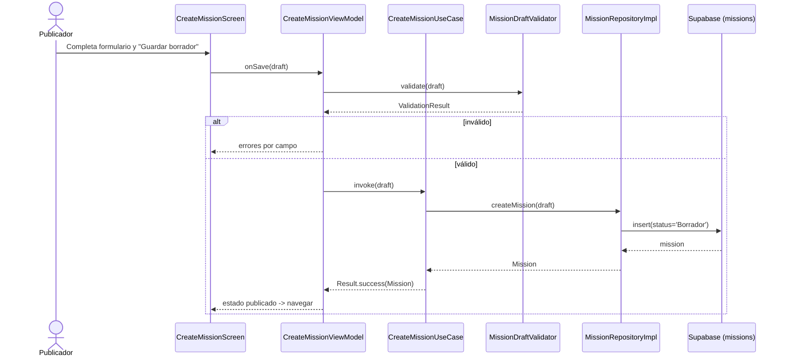

# Design: Publicación de misión de campo (HU-016, HU-017, HU-020, HU-021, HU-126)

> Base: `develop` @ `a036b6a`. Arquitectura por capas vigente (`domain/{model,repository,usecase}`, `data/repository`, `ui/<feature>`, `di/`), navegación manual por `mutableStateOf<AppDestination>`, Koin, supabase-kt 2.6.0, Compose BOM 2025.01.00 (Material 3 incluye `DatePicker`/`TimePicker`).

## Technical Approach

Se extiende el patrón existente sin introducir dependencias nuevas:

- **Repositorio lanza, caso de uso envuelve en `Result<T>`** (igual que `GetMissionsUseCase`).
- **Validadores puros** con `java.time.Clock` inyectado para tests deterministas (igual que `BirthDateValidator`).
- **Un ViewModel por pantalla** con `StateFlow<XUiState>` (igual que `MissionViewModel`).
- **Navegación manual**: se agrega `AppDestination.PublishMission` y se cablea `MainMenuDestination.PUBLISH_MISSION`.
- **Textos en español** centralizados en `ui/missions/MissionMessages.kt` (patrón `ui/auth/AuthMessages.kt`).

## Architecture Decisions

| # | Decisión | Alternativa rechazada | Rationale |
|---|----------|----------------------|-----------|
| D1 | **Aprobado:** agregar `meeting_point TEXT NULL` a `missions` y mantener `location` para el mapa | Guardar la dirección dentro de `description`; usar solo lat/lng | La BD no tiene dónde guardar "Parque Dog Cali" como texto y el criterio de aceptación exige ese texto. Es un cambio aditivo y no destructivo |
| D2 | **Exigir fecha y hora desde el borrador** (`date_time NOT NULL` ya existe) | `ALTER TABLE ... DROP NOT NULL` | Evita migración y mantiene el borrador completo; HU-016 ya pide fecha/hora |
| D3 | Enviar `location` como **EWKT** (`SRID=4326;POINT(lng lat)`) y validar el mapeo en el spike | Cambiar `location` a `TEXT` | Menor cambio; si falla, se ajusta el DTO en `data`, no el esquema |
| D4 | Implementar el **selector de modalidad mínimo** dentro de HU-016 | Posponerlo hasta HU-015 (Post-MVP) | HU-016 lo necesita como precondición; el alcance completo de HU-015 queda fuera |
| D5 | `CreateMissionDraft` como modelo de dominio independiente de `Mission` | Reutilizar `Mission` con campos nulos | Evita estados inválidos y acoplar el formulario al modelo de lectura |
| D6 | Estado inicial `Borrador` explícito en el `insert` | Confiar en el `DEFAULT 'Publicada'` | El default publicaría el borrador; debe ser explícito |
| D7 | Publicar con `update({ status = "Publicada" })` filtrando por `id` | RPC nueva en Postgres | RLS `Publishers can update missions` ya lo permite; menos superficie |
| D8 | Errores de UI como `sealed interface MissionError` + mensajes en `MissionMessages.kt` | `String` sueltos en el estado | Tests verifican tipos, no textos (patrón del equipo) |
| D9 | Validar que `meeting_point` mencione Cali y que las coordenadas estén en un rectángulo geográfico aproximado | Geocodificación/PostGIS o perímetro catastral exacto | Sin API de geocoding en el MVP; el mapa podrá refinar la ubicación posteriormente |
| D10 | `PublishMissionUseCase` revalida los campos obligatorios antes de publicar | Confiar solo en la UI | Regla de negocio HU-017: punto de encuentro definido |
| D11 | Sin `navigation-compose`; se mantiene el `when` manual | Migrar a NavHost | No reescribir la navegación del equipo |
| D12 | Fecha y hora se combinan en un `LocalDateTime` con zona `America/Bogota` y se serializan ISO-8601 | Guardar fecha y hora en columnas separadas | El esquema tiene un único `date_time` |
| D13 | Para HU-016, capturar latitud/longitud explícitamente; una futura selección en mapa poblará el mismo par de valores | Inventar coordenadas a partir del texto del punto de encuentro | La tabla requiere `location GEOGRAPHY(POINT)` para misiones de campo; la captura manual evita servicios externos y permite integrar el mapa después |
| D14 | Agregar política RLS SELECT para que cada publicador lea sus propios borradores | Hacer públicos los borradores o no pedir la fila tras insert/update | Supabase necesita devolver la misión insertada y HU-017 debe operar sobre el borrador sin exponerlo a otros usuarios |

## Decisiones tomadas (2026-11-05)

| # | Decisión | Rationale |
|---|---|---|
| D1 | Agregar `meeting_point TEXT NULL` a `missions` (cambio aditivo) | Es la única forma de cumplir el criterio "punto de encuentro 'Parque Dog Cali'". No rompe datos ni políticas RLS y `location` se conserva para el mapa |
| D2 | Fecha y hora **obligatorias** desde el borrador; no se toca `date_time` | Evita una migración extra sobre la BD compartida y el borrador queda completo, solo no visible |
| D4 | Selector de modalidad mínimo **dentro de HU-016**; HU-015 se descopea del sprint | HU-016 lo necesita como precondición; el alcance completo de HU-015 (misiones remotas) ya está marcado Post-MVP en Jira |
| PRs | **3 PRs**: `hu/HU-016` (incluye fecha/hora con commits separados), `hu/HU-017`, `hu/HU-126` | El formulario, la fecha y la hora son inseparables en la práctica; separarlos en 3 PRs multiplicaría el costo de revisión con el sprint cerrándose. Cada commit referencia su HU para conservar trazabilidad |
| Entorno | Verificación local con JDK 17 y Android SDK, más CI al abrir PR | El entorno quedó instalado y `assembleDebug`, ktlint, detekt y tests se ejecutan localmente |
| D13 | Capturar latitud y longitud junto al punto de encuentro; el futuro mapa poblará el mismo par de coordenadas | Usar siempre el centro de Cali como ubicación | `missions.location` es obligatorio para modalidad `campo`; no se debe persistir una ubicación inventada |
| D14 | Crear política `Publishers can view own drafts`: `authenticated`, `auth.uid() = publisher_id AND status = 'Borrador'` | Exponer borradores con la política pública o depender de una fila en memoria | Permite leer solo los propios borradores y es necesaria para el `insert(...).select()` de Supabase; debe coordinarse con el Líder Técnico antes de aplicarla |

### SQL propuesto para D1

```sql
-- supabase/changes/2026-11-05_missions_meeting_point.sql
ALTER TABLE public.missions ADD COLUMN IF NOT EXISTS meeting_point TEXT NULL;
COMMENT ON COLUMN public.missions.meeting_point IS 'Punto de encuentro textual (solo misiones de campo)';
```

Se aplica manualmente en la BD compartida, coordinado con el Líder Técnico, y se refleja también en `supabase/schema.sql`. Reversa: `ALTER TABLE public.missions DROP COLUMN IF EXISTS meeting_point;`.

La política D14 se prepara en `supabase/changes/2026-11-05_missions_publish_draft_policy.sql`; tampoco se aplica sin coordinación. Reversa, si se aprueba y aplica: `DROP POLICY IF EXISTS "Publishers can view own drafts" ON public.missions;`.

### Consecuencia de D4 en Jira

Recomendación: sacar **SCRUM-38 (HU-015)** del Sprint 1 y dejar solo las 5 historias restantes (SCRUM-37, SCRUM-39, SCRUM-42, SCRUM-43, SCRUM-148). No se modifica Jira sin confirmación del equipo.

## Contracts

```kotlin
// domain/model/CreateMissionDraft.kt
data class CreateMissionDraft(
    val title: String,
    val description: String,
    val requirements: String,
    val category: String?,
    val modality: MissionModality,      // CAMPO | REMOTA
    val date: LocalDate,
    val time: LocalTime,
val meetingPoint: String,           // solo CAMPO
val latitude: Double?,              // solo CAMPO; fuente inicial: formulario manual
val longitude: Double?,             // solo CAMPO; el mapa podrá poblarlos después
val maxParticipants: Int,
)

// domain/repository/MissionRepository.kt (extensión)
suspend fun createMission(draft: CreateMissionDraft): Mission
suspend fun publishMission(id: String): Mission

// domain/usecase
class CreateMissionUseCase(...) { suspend operator fun invoke(draft: CreateMissionDraft): Result<Mission> }
class PublishMissionUseCase(...) { suspend operator fun invoke(missionId: String): Result<Mission> }

// domain/validation/MissionDraftValidator.kt
class MissionDraftValidator(private val clock: Clock) {
    fun validate(draft: CreateMissionDraft): ValidationResult
}
```

## Mapping to Supabase

| Dominio | Columna | Formato |
|---|---|---|
| `title` | `title` | `TEXT` |
| `description` | `description` | `TEXT` |
| `requirements` | `requirements` | `TEXT` |
| `category` | `category` | `TEXT` (null permitido) |
| `modality` | `modality` | `'campo'` / `'remota'` |
| `date` + `time` | `date_time` | ISO-8601 con offset (`2026-11-15T10:00:00-05:00`) |
| `meetingPoint` | `meeting_point` (D1) | texto del punto de encuentro |
| `latitude` + `longitude` | `location` | `SRID=4326;POINT(longitude latitude)` |
| `maxParticipants` | `max_participants` | `INTEGER` |
| — | `status` | `'Borrador'` al crear, `'Publicada'` al publicar |
| — | `publisher_id` | `auth.uid()` (RLS) |

`Mission` en `domain/model` debe mapear `meeting_point` (D1). El spike de lectura confirmó que PostgREST devuelve `location GEOGRAPHY(POINT)` como EWKB hexadecimal y que `Mission.location: String?` lo decodifica con `supabase-kt`.

### Spike 0.2 — evidencia de lectura (2026-11-05)

- `GET /rest/v1/missions?select=id,modality,date_time,location&status=neq.Borrador&limit=1` devolvió `location` como EWKB hexadecimal (`0101000020E610...`) y `date_time` como ISO-8601 con offset (`2026-11-07T13:22:54.556641+00:00`).
- La lista de misiones de la app decodificó esa fila usando `Mission.location: String?` y mostró la fecha en formato legible; no hace falta cambiar el tipo para el lector actual.
- **No se ejecutó un insert autenticado**, así que la política RLS de inserción y la aceptación de EWKT de entrada aún no están verificadas.
- La Data API confirmó que la columna `meeting_point` **no existe** en el proyecto compartido (`42703`, `column missions.meeting_point does not exist`). La migración local se prepara, pero su aplicación se debe coordinar con el Líder Técnico antes de probar escrituras.
- El `schema.sql` del repo no tenía política SELECT para los borradores propios. Se añadió D14 de forma aditiva para permitir la lectura al publicador autenticado sin hacerlos públicos; en la BD compartida su existencia aún no está verificada.
- El flujo de captura de coordenadas será explícito en HU-016. El punto futuro del mapa podrá escribir las mismas propiedades `latitude`/`longitude`; no se derivarán coordenadas del texto ni se usará el centro de Cali como sustituto. La validación inicial exige que el texto del punto incluya "Cali" y usa un rectángulo geográfico aproximado (`3.30..3.60`, `-76.65..-76.35`), no un perímetro catastral; la selección en mapa podrá sustituir ese aproximado después.

## Flow



Publicar reutiliza el mismo flujo: `PublishMissionUseCase` valida requisitos y llama `update({status:'Publicada'})`.

## File Changes

Base `app/src/main/java/com/groovycow/misionessecundarias/`.

| Archivo | Acción | Descripción |
|---|---|---|
| `domain/model/MissionModality.kt` | Create | Enum `CAMPO`/`REMOTA` con valor de BD |
| `domain/model/CreateMissionDraft.kt` | Create | Borrador tipado |
| `domain/model/MissionError.kt` | Create | Errores de dominio/UI |
| `domain/model/Mission.kt` | Modify | `meetingPoint` (si D1) y mapeo de `location` |
| `domain/validation/MissionDraftValidator.kt` | Create | Validaciones de HU-016/020/021 |
| `domain/repository/MissionRepository.kt` | Modify | `createMission`, `publishMission` |
| `domain/usecase/CreateMissionUseCase.kt` | Create | `Result<Mission>` |
| `domain/usecase/PublishMissionUseCase.kt` | Create | `Result<Mission>` |
| `data/repository/MissionRepositoryImpl.kt` | Modify | `insert`/`update`, mapeo de fecha y ubicación |
| `ui/missions/MissionMessages.kt` | Create | Textos en español |
| `ui/missions/create/CreateMissionScreen.kt` | Create | Formulario + pickers |
| `ui/missions/create/CreateMissionViewModel.kt` | Create | `StateFlow<CreateMissionUiState>` |
| `ui/missions/MissionDetailScreen.kt` | Modify | Tarjeta de aviso (HU-126) |
| `ui/navigation/AppNavigation.kt` | Modify | `PublishMission` + rama |
| `di/RepositoryModule.kt` | Modify | Casos de uso + ViewModel |
| `app/src/test/**/MissionDraftValidatorTest.kt` | Create | TDD |
| `app/src/test/**/CreateMissionUseCaseTest.kt` | Create | TDD |
| `app/src/test/**/PublishMissionUseCaseTest.kt` | Create | TDD |
| `app/src/test/**/CreateMissionViewModelTest.kt` | Create | TDD |
| `supabase/schema.sql` + `supabase/changes/2026-11-05_missions_meeting_point.sql` | Modify/New | `meeting_point TEXT NULL` (D1) |

## Testing Strategy

- **TDD estricto**: RED -> GREEN -> REFACTOR en cada tarea de `tasks.md`.
- Validadores: fecha pasada, fecha hoy, cupos, obligatorios, modalidad remota sin ubicación.
- Casos de uso con MockK: éxito, excepción del repositorio, `CancellationException` relanzada.
- ViewModel con `MainDispatcherRule` (ya existe en `testutil`): `isLoading`, errores por campo, no llamar al caso de uso si hay errores, evitar doble envío.
- Sin SDK local: la verificación real es CI (`ktlintCheck`, `detekt`, `testDebugUnitTest`, `assembleDebug`).

## Rollback

- Revertir PRs en `develop` (orden inverso).
- Si se aplicó D1: script de reversa `ALTER TABLE missions DROP COLUMN meeting_point;` coordinado con el equipo.
- Sin cambios destructivos ni migraciones de datos.
